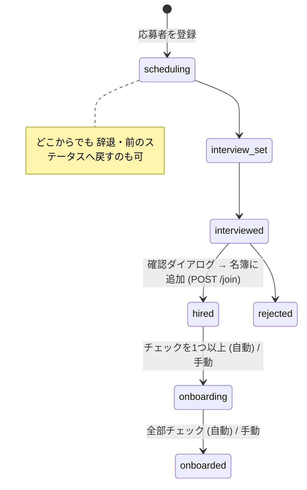

# 人事アプリ（面談 → 採用 → オンボーディング）設計

## 目次

- [目的とスコープ](#目的とスコープ)
- [ステータス](#ステータス)
- [データモデル](#データモデル)
- [名簿・参加届とのつながり](#名簿参加届とのつながり)
- [権限（ロール管理）](#権限ロール管理)
- [API](#api)
- [フロントエンド](#フロントエンド)
- [リリース手順と migration](#リリース手順と-migration)
- [フェーズ2 以降の TODO](#フェーズ2-以降の-todo)

## 目的とスコープ

応募してきた人の面談日程の調整から、面談・採用（または不採用/辞退）を経て、運営メンバー・名簿への追加と
**オンボーディング**（最初にやってほしいことの完了）までを、1 枚の表で追えるようにする。

フェーズ1（この PR）: 応募者の表（絞り込み・並べ替え・検索・その場でステータス変更）・面談日・メモ/履歴・
採用（確認 → 名簿に追加）・オンボーディングのチェックリスト（ステータス自動更新）・ランチャー/ロール管理への登録・demo。

## ステータス

人事の運用に合わせた 8 つ（この順で表示）:

| キー | 表示 | 名簿 |
|---|---|---|
| `scheduling` | 面談日程調整中 | — |
| `interview_set` | 面談確定 | — |
| `interviewed` | 面談済み | — |
| `hired` | 採用 | 在籍として追加済み |
| `rejected` | 不採用 | — |
| `onboarding` | オンボーディング調整 | 在籍 |
| `onboarded` | オンボーディング完了 | 在籍 |
| `withdrawn` | 辞退 | — |

### 遷移の規則（SoT: `@dub/types` の `hr.canTransition` / `hr.requiresJoin`）

- **寛容**: 人事が誤操作を直せるよう、前のステータスへ戻すことも含めて **どこからどこへでも** 動かせる（同じステータスへの移動だけ不可）。辞退はどこからでも。
- **例外は 1 つだけ**: `採用` / `オンボーディング調整` / `オンボーディング完了`（名簿前提のステータス = `hr.ROSTER_STAGES`）は、**名簿に結ばれている人だけ**。
  まだ名簿にいない人をそこへ動かすのは `POST /join`（採用）専用で、画面では **確認ダイアログ → 名簿に追加** を必ず通す（黙って追加しない）。`/stage` で送ると 409 `HR_JOIN_REQUIRED`。
  確認ダイアログで「オンボーディング調整/完了」を選んでいた場合は、採用のあと続けてそのステータスにする。
- 一度名簿に入った人は、その後 採用 ⇄ 不採用 ⇄ オンボーディング… も普通のステータス変更（名簿の行は名簿側で管理し、二重追加しない）。
- **オンボーディング完了の自動更新**: オンボーディングのチェックを付けると、1 つ以上で `採用 → オンボーディング調整`、全部で `→ オンボーディング完了`、完了から外すと `→ オンボーディング調整` に自動で動く（履歴に「オンボーディングのチェックで自動更新」）。オンボーディング完了は表のプルダウンから手動でも選べる。

### 絞り込み（表の上のチップ・件数つき）

| チップ | 条件 |
|---|---|
| すべて | 全員（論理削除を除く） |
| オンボーディング前 | `採用` + `オンボーディング調整`（= 採用済みでオンボーディングが終わっていない人。`hr.BEFORE_ONBOARDING_STAGES`） |
| 各ステータス | そのステータスの人 |

## データモデル

D1 `member` namespace に新規テーブル 3 つ（`infra/d1/migrations/member/0017_hr.sql`、additive）。

| テーブル | 役割 |
|---|---|
| `member_hr_applicants` | 応募者。氏名・連絡先・学科/学年・希望チーム・応募経路・志望動機・面談日 (`interview_at`)・ステータス (`stage`)・`member_id`（参加後の名簿行）・`participation_id`（元の参加届・任意）・`version`（楽観ロック）・`archived_at`（論理削除） |
| `member_hr_events` | 履歴（追記のみ）。`created` / `stage`（from→to + 理由）/ `note` / `joined`（採用）。表の「メモ」列は本文のある最新の履歴 (`latestNote`) |
| `member_hr_onboarding_checks` | オンボーディングのチェック状態（`person_id` × `item_id`）。項目そのものは持たない |

## 名簿・参加届とのつながり

**名簿（`member_people`）を複製しない** のが原則。

- **採用**（`POST /members/hr/applicants/:id/join`、名簿にまだいない人なら どのステータスからでも）
  - `memberId` 省略: 応募内容から在籍（`added`）の名簿行を作る。作成は既存の `MemberService.createMember` をそのまま使う（名簿の検証・採番・並び順のロジックを二重に持たない）。希望チームがあればそのチームに所属。
  - `memberId` 指定: 既存の名簿行に結ぶ（招待中/検討中なら在籍に上げる）。打診済みの人が応募フォームからも来たケース用。
- **オンボーディング**: 対象は名簿前提のステータス（採用 / オンボーディング調整 / オンボーディング完了）の人。項目は参加届アプリの「オンボーディング案内」（`member_onboarding_items`、公開ページ `/onboarding` と同じもの）をテンプレートとしてそのまま使う。人事側はチェック状態だけを持つので、案内を編集すればチェックリストにも反映される。
- **参加届**: 公開フォーム `/participate` の 参加届 は従来どおり名簿反映フロー（参加届アプリ）。人事の応募者は `participation_id` で参加届と結べるよう列だけ用意した（取り込みはフェーズ2）。

### 実装場所の判断（新サービスではなく member-service を拡張）

- 採用は名簿行の作成と同じトランザクション境界（同じ D1・同じ Worker）にあるべきで、別サービスにすると Service Binding 越しの 2 段書き込みと失敗時の補償が要る。
- オンボーディング項目・チーム・名簿をすべて同じ namespace から読める。
- api-gateway は `members` セグメントを丸ごと member-service に流しているので、ゲートウェイ・wrangler・D1 バインディングの追加が不要（$0 運用を崩さない）。
- 人事のコードは `src/hr-repo.ts` / `src/hr-service.ts` に分け、`MemberRepo` / `MemberService` は太らせない。将来切り出すときはこの 2 ファイルとテーブルを移すだけで済む。

## 権限（ロール管理）

| キー | 意味 | 既定 |
|---|---|---|
| `app:hr:view` / `app:hr:edit` | 人事アプリの 無効/閲覧/編集（ロール管理の 3 段階） | admin のみ |
| `hr:read` | 応募者・履歴・オンボーディング進捗の閲覧（個人情報） | admin のみ |
| `hr:write` | 応募者登録・ステータス変更・面談日・メモ・オンボーディングのチェック | admin のみ |
| `hr:admin` ⚠ | 採用（名簿への追加）・応募の削除 | admin のみ |

- `APP_MANIFEST` に `hr`（domain `hr`、`detailPermissions: [hr:read, hr:write, hr:admin]`）を登録 → ロール管理の行と「詳細設定」に自動で出る。
- `identity/0025_hr_app_perms.sql` で `role_sys_admin` にだけ付与。他ロールはロール管理で明示的にオン。
- 表（`services/member-service/src/policy-table.ts`）:
  - 読み取り = `appLevel("hr", "view", "hr:read")`
  - 登録・更新・ステータス・メモ・チェック = `appLevel("hr", "edit", "hr:write")`
  - 採用・削除 = `appLevel("hr", "edit", "hr:admin")`（画面でも hr:admin が無いと採用系の選択肢は押せない）
  - 人事アプリが無効なら詳細キーだけでは何も触れない（ロール行列テストで固定）。

## API

すべて `/api/v1/members/hr/*`（gateway → member-service `/members/hr/*`）。型は `@dub/types` の `hr`。

| メソッド/パス | 内容 |
|---|---|
| `GET /members/hr/applicants` | 一覧（論理削除を除く・`latestNote` つき） |
| `POST /members/hr/applicants` | 登録（`面談日程調整中` + 履歴 `created`） |
| `GET /members/hr/applicants/:id` | 詳細 + 履歴 |
| `PATCH /members/hr/applicants/:id` | 項目・面談日の更新（`expectedVersion` 必須・409） |
| `DELETE /members/hr/applicants/:id` | 論理削除 |
| `POST /members/hr/applicants/:id/stage` | ステータス変更（名簿にいない人の採用系は 409 `HR_JOIN_REQUIRED`） |
| `POST /members/hr/applicants/:id/notes` | メモ追加 |
| `POST /members/hr/applicants/:id/join` | 採用（名簿へ追加。既に名簿にいれば 409） |
| `GET /members/hr/onboarding` | 採用済みの人ごとの進捗 + 項目 |
| `PUT /members/hr/onboarding/:memberId/items/:itemId` | チェックのオン/オフ（ステータス自動更新） |

## フロントエンド

`apps/fe2-app-shell/src/features/hr/`（LP管理 と同じ FE2 ローカル feature）。

- `/hr` 応募者（表）: 1 人 1 行。列 = 氏名 / 学科・学年 / 希望チーム / ステータス / 面談日 / 更新日 / メモ。
  列見出しで並べ替え（既定は更新日の新しい順）、氏名・フリガナ・学科で検索、上のチップで絞り込み（件数つき）。
  ステータスは行のプルダウンでその場で変更（楽観的 UI・失敗で戻る）。名簿にいない人の採用系は確認ダイアログ。行を押すと詳細ドロワー。
- 詳細ドロワー: ステータス・面談日（日時入力・楽観的）・項目・メモ・履歴・削除（確認ダイアログ）。
- `/hr/onboarding`: 採用済みの人ごとのチェックリスト・進捗バー・ステータスバッジ（楽観的 UI）。
- 制御コンポーネント（チェックボックス・プルダウン）は「押した値」を同じ描画で重ねて表示する（`usePendingOverlay`）。
  以前はミューテーションの onMutate が走るまでの一瞬だけ古い値に戻って見えていた（チェックが一瞬外れる不具合）。
- 進捗バーの色は以前存在しないトークン（`--dub-color-brand-6`）を参照していて完了でも空に見えていた → `brand-500`（完了は `success-500`）に修正。
- 読み込み中はスケルトン、失敗は再試行つき ErrorState。閲覧者にはプルダウン/書き込みボタンを出さない（`useAppCapability("hr")` + `hr:write`/`hr:admin`）。
- ランチャー・ホームに「人事」。`releaseGate.PUBLISHED_APPS` には入れていないので admin 以外はグレー表示。
- demo（`VITE_DEMO=1`）: `lib/demo-seed.tsx` の名簿 demo の中に人事 store（全 8 ステータスに 1 人以上）。採用で demo 名簿に在籍が増え、チェックでステータスが自動で動く。

## リリース手順と migration

1. demo で確認 → 本番デプロイ（admin のみ利用可）→ メンバー公開（`PUBLISHED_APPS` に `hr` を足す 1 行）。
2. **本番デプロイ前に D1 migration を適用する**（前方のみ・additive）:
   - `infra/d1/migrations/member/0017_hr.sql`（新規テーブル 3 つ）
   - `infra/d1/migrations/identity/0025_hr_app_perms.sql`（admin への 5 キー付与）

## フェーズ2 以降の TODO

- 公開応募フォーム（未ログインで応募 → `面談日程調整中` で登録。Turnstile・レート制限は参加届と同じ gateway 経路）。
- 参加届 → 応募者の取り込み（`participation_id` で紐付け）、または応募者 → 参加届フォームの案内メール送信。
- 面談日程（カレンダー/ミーティング連携）と面談官のアサイン、評価欄。
- ステータス変更時の通知（担当者・本人へのメール）とメールテンプレート。
- 採用時のアカウント発行（参加届アプリの「メール発行 + 招待」フローを再利用）。
- オンボーディング: 人事経由でない名簿メンバーも対象に（期間指定）、担当者・期限、全員完了の通知。
- 応募者の検索・CSV 出力、応募経路別の集計。
- 個人情報の保持期間（不採用/辞退の一定期間後の削除）。
- 名簿側（運営メンバー詳細）から人事履歴へのリンク。
- 実ブラウザ E2E を `apps/fe2-app-shell/e2e/` に spec 化（今回は手動 Playwright で検証）。
