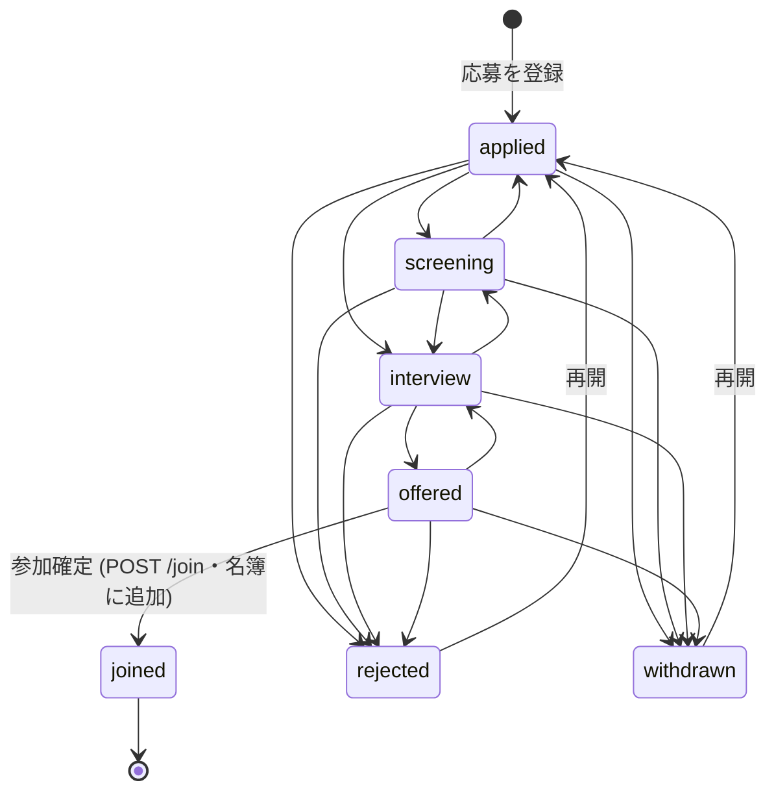

# 人事アプリ（応募 → 選考 → 参加 → オンボーディング）設計

## 目次

- [目的とスコープ](#目的とスコープ)
- [段階（ステート）](#段階ステート)
- [データモデル](#データモデル)
- [名簿・参加届とのつながり](#名簿参加届とのつながり)
- [権限（ロール管理）](#権限ロール管理)
- [API](#api)
- [フロントエンド](#フロントエンド)
- [リリース手順と migration](#リリース手順と-migration)
- [フェーズ2 以降の TODO](#フェーズ2-以降の-todo)

## 目的とスコープ

新しく入りたい人の **応募** から、書類選考・面談・内定（または不採用/辞退）を経て **参加**（名簿に在籍として追加）し、
**オンボーディング**（最初にやってほしいことの完了）までを 1 つのアプリで追えるようにする。

フェーズ1（この PR）: 応募者 CRUD・段階遷移・メモ/履歴・参加確定・オンボーディングのチェックリスト・ランチャー/ロール管理への登録・demo。

## 段階（ステート）

| 段階 | 表示 | 備考 |
|---|---|---|
| `applied` | 応募 | 登録直後 |
| `screening` | 書類選考 | |
| `interview` | 面談 | |
| `offered` | 内定 | ここからだけ参加確定できる |
| `joined` | 参加 | 名簿に在籍として入った。以降は名簿側で管理（戻せない） |
| `rejected` | 不採用 | 応募に戻して再開できる |
| `withdrawn` | 辞退 | 同上 |

- 遷移表は `@dub/types` の `hr.STAGE_TRANSITIONS` が唯一の真実源。member-service と demo transport が同じ関数（`hr.canTransition`）で判定する。
- `joined` へは段階変更 API では進めない（名簿への追加を伴うため `POST /join` 専用）。
- オンボーディング完了は段階ではなく **派生値**（その人の全案内項目にチェックが付いたら完了）。

## データモデル

D1 `member` namespace に新規テーブル 3 つ（`infra/d1/migrations/member/0017_hr.sql`、additive）。

| テーブル | 役割 |
|---|---|
| `member_hr_applicants` | 応募者。氏名・連絡先・学科/学年・希望チーム・応募経路・志望動機・段階・`member_id`（参加後の名簿行）・`participation_id`（元の参加届・任意）・`version`（楽観ロック）・`archived_at`（論理削除） |
| `member_hr_events` | 履歴（追記のみ）。`created` / `stage`（from→to + 理由）/ `note` / `joined` |
| `member_hr_onboarding_checks` | オンボーディングのチェック状態（`person_id` × `item_id`）。項目そのものは持たない |

## 名簿・参加届とのつながり

**名簿（`member_people`）を複製しない** のが原則。

- **参加確定**（`POST /members/hr/applicants/:id/join`、内定のときだけ）
  - `memberId` 省略: 応募内容から在籍（`added`）の名簿行を作る。作成は既存の `MemberService.createMember` をそのまま使う（名簿の検証・採番・並び順のロジックを二重に持たない）。希望チームがあればそのチームに所属。
  - `memberId` 指定: 既存の名簿行に結ぶ（招待中/検討中なら在籍に上げる）。打診済みの人が応募フォームからも来たケース用。
- **オンボーディング**: 項目は参加届アプリの「オンボーディング案内」（`member_onboarding_items`、公開ページ `/onboarding` と同じもの）をテンプレートとしてそのまま使う。人事側はチェック状態だけを持つので、案内を編集すればチェックリストにも反映される。
- **参加届**: 公開フォーム `/participate` の 参加届 は従来どおり名簿反映フロー（参加届アプリ）。人事の応募者は `participation_id` で参加届と結べるよう列だけ用意した（取り込みはフェーズ2）。

### 実装場所の判断（新サービスではなく member-service を拡張）

- 参加確定は名簿行の作成と同じトランザクション境界（同じ D1・同じ Worker）にあるべきで、別サービスにすると Service Binding 越しの 2 段書き込みと失敗時の補償が要る。
- オンボーディング項目・チーム・名簿をすべて同じ namespace から読める。
- api-gateway は `members` セグメントを丸ごと member-service に流しているので、ゲートウェイ・wrangler・D1 バインディングの追加が不要（$0 運用を崩さない）。
- 人事のコードは `src/hr-repo.ts` / `src/hr-service.ts` に分け、`MemberRepo` / `MemberService` は太らせない。将来切り出すときはこの 2 ファイルとテーブルを移すだけで済む。

## 権限（ロール管理）

| キー | 意味 | 既定 |
|---|---|---|
| `app:hr:view` / `app:hr:edit` | 人事アプリの 無効/閲覧/編集（ロール管理の 3 段階） | admin のみ |
| `hr:read` | 応募者・履歴・オンボーディング進捗の閲覧（個人情報） | admin のみ |
| `hr:write` | 応募者登録・段階移動・メモ・オンボーディングのチェック | admin のみ |
| `hr:admin` ⚠ | 参加確定（名簿への追加）・応募の削除 | admin のみ |

- `APP_MANIFEST` に `hr`（domain `hr`、`detailPermissions: [hr:read, hr:write, hr:admin]`）を登録 → ロール管理の行と「詳細設定」に自動で出る。
- `identity/0025_hr_app_perms.sql` で `role_sys_admin` にだけ付与。他ロールはロール管理で明示的にオン。
- 表（`services/member-service/src/policy-table.ts`）:
  - 読み取り = `appLevel("hr", "view", "hr:read")`
  - 登録・更新・段階・メモ・チェック = `appLevel("hr", "edit", "hr:write")`
  - 参加確定・削除 = `appLevel("hr", "edit", "hr:admin")`
  - 人事アプリが無効なら詳細キーだけでは何も触れない（ロール行列テストで固定）。

## API

すべて `/api/v1/members/hr/*`（gateway → member-service `/members/hr/*`）。型は `@dub/types` の `hr`。

| メソッド/パス | 内容 |
|---|---|
| `GET /members/hr/applicants` | 一覧（論理削除を除く・新しい順） |
| `POST /members/hr/applicants` | 登録（段階 `applied` + 履歴 `created`） |
| `GET /members/hr/applicants/:id` | 詳細 + 履歴 |
| `PATCH /members/hr/applicants/:id` | 項目更新（`expectedVersion` 必須・409） |
| `DELETE /members/hr/applicants/:id` | 論理削除 |
| `POST /members/hr/applicants/:id/stage` | 段階変更（遷移表で検証・不正は 409） |
| `POST /members/hr/applicants/:id/notes` | メモ追加 |
| `POST /members/hr/applicants/:id/join` | 参加確定（内定のみ・名簿へ） |
| `GET /members/hr/onboarding` | 参加済みメンバーごとの進捗 + 項目 |
| `PUT /members/hr/onboarding/:memberId/items/:itemId` | チェックのオン/オフ |

## フロントエンド

`apps/fe2-app-shell/src/features/hr/`（LP管理 と同じ FE2 ローカル feature）。

- `/hr` パイプライン（カンバン）: ドラッグ or カードの「次へ / 戻す」で段階移動（楽観的 UI・失敗でロールバック）。不採用・辞退は下に畳んで表示。
- `/hr/list` 応募者一覧: 段階で絞り込み（選考中/参加/不採用/辞退/すべて）。
- 詳細ドロワー: 項目・段階変更・メモ・履歴・参加確定（確認ダイアログ）・削除（確認ダイアログ）。
- `/hr/onboarding`: 新メンバーごとのチェックリストと進捗バー（楽観的 UI）。
- 読み込み中はスケルトン、失敗は再試行つき ErrorState。閲覧者には書き込みボタンを出さない（`useAppCapability("hr")` + `hr:write`/`hr:admin`）。
- ランチャー・ホームに「人事」。`releaseGate.PUBLISHED_APPS` には入れていないので admin 以外はグレー表示。
- demo（`VITE_DEMO=1`）: `lib/demo-seed.tsx` の名簿 demo の中に人事 store があり、参加確定で demo 名簿に在籍が増える。

## リリース手順と migration

1. demo で確認 → 本番デプロイ（admin のみ利用可）→ メンバー公開（`PUBLISHED_APPS` に `hr` を足す 1 行）。
2. **本番デプロイ前に D1 migration を適用する**（前方のみ・additive）:
   - `infra/d1/migrations/member/0017_hr.sql`（新規テーブル 3 つ）
   - `infra/d1/migrations/identity/0025_hr_app_perms.sql`（admin への 5 キー付与）

## フェーズ2 以降の TODO

- 公開応募フォーム（未ログインで応募 → `applied` で登録。Turnstile・レート制限は参加届と同じ gateway 経路）。
- 参加届 → 応募者の取り込み（`participation_id` で紐付け）、または応募者 → 参加届フォームの案内メール送信。
- 面談日程（カレンダー/ミーティング連携）と面談官のアサイン、評価欄。
- 段階変更時の通知（担当者・本人へのメール）とメールテンプレート。
- 参加確定時のアカウント発行（参加届アプリの「メール発行 + 招待」フローを再利用）。
- オンボーディング: 人事経由でない名簿メンバーも対象に（期間指定）、担当者・期限、全員完了の通知。
- 応募者の検索・CSV 出力、応募経路別の集計。
- 個人情報の保持期間（不採用/辞退の一定期間後の削除）。
- 名簿側（運営メンバー詳細）から人事履歴へのリンク。
- 実ブラウザ E2E を `apps/fe2-app-shell/e2e/` に spec 化（今回は手動 Playwright で検証）。
